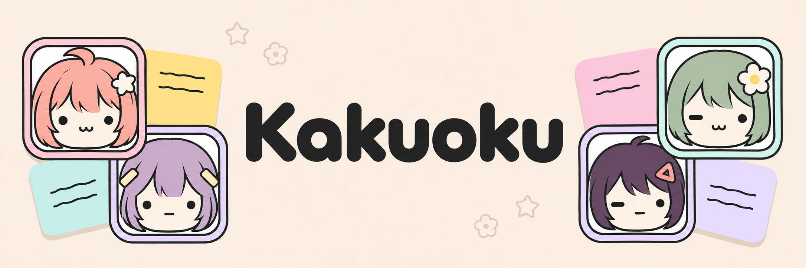

**English** | [Русский](README.ru.md)

# Kakuoku

A small notebook where each card is a conversation about a topic. Capture a
thought, a link, or a file; return to it later, or ask AI to bring related notes
together. Google Keep-inspired masonry, warm paper colors, subtle patterns,
and illustrated avatars give each conversation its own character.

The web app runs in Docker on **Windows, Linux, and macOS**. Docker also provides
the isolation layer. A full desktop GUI for selecting a mounted data directory
is planned for a later stage. Run commands from the cloned repository root.

## Run the web app

Use Docker Engine with Compose v2 on Linux, or Docker Desktop with Linux
containers on Windows and macOS. Host Node.js/npm is not required for the web app.
For a **fresh installation without existing production data**, run the same
commands in PowerShell or a Linux/macOS terminal:

```sh
docker volume create kakuoku-production-data
docker compose build --pull
docker compose up -d
```

Open **http://localhost:3101** or **http://127.0.0.1:3101**. One service serves
the frontend and HTTP API. Agentation is excluded from production.

If you already have notes, follow the [storage migration guide](docs/rename-migration.md)
(Russian) before creating a new volume. Platform setup and folder mounting are
covered in the [deployment guide](docs/deployment.md) (Russian).

The app starts as a notebook. To enable AI, enter your API key in Settings.
Saving makes no provider request. An `.env` file is optional; see
[.env.example](.env.example) for model settings and `KAKUOKU_DATA_VOLUME` to select
an existing volume. Compose deliberately does not pass the AI key in the container
environment. A server environment fallback remains available for custom deployments.

```sh
docker compose stop
docker compose start
docker compose logs --tail=100 app
```

Stopping or removing the container **keeps your notes**. The dedicated external
volume is mounted only at `/app/data` and contains SQLite, settings, profile,
legacy photos, new media, and organization results. If the selected volume does
not exist, Compose fails instead of silently creating empty storage. The separate
`.data/demo` database is never mounted into production.

To mount your own folder, use [compose.override.example.yaml](compose.override.example.yaml).
Set `KAKUOKU_DATA_DIR` only in an ignored local `.env`; do not commit personal paths.
Mounting a new folder does not copy existing data. See the
[folder and migration instructions](docs/deployment.md#своя-папка-данных) (Russian).

Before updating, make a backup following [docs/backend.md](docs/backend.md)
(Russian), then reuse the existing volume:

```sh
docker compose build --pull
docker compose up -d --no-deps app
```

Migrations add tables and columns. Do not run multiple servers against the same
volume. On `SIGTERM`, the server stops accepting requests, cancels network calls,
and allows active work up to 25 seconds to finish; Compose waits 35 seconds.
Messages are saved before AI calls. Paid work does not automatically resume
after a restart.

Use `docker compose down` to remove the app while keeping data. Deleting the
production volume is a separate, irreversible action; check its actual name if
you set `KAKUOKU_DATA_VOLUME`. Normal updates do not remove volumes. There is no
automatic import from an old Podman container's writable layer; keep any old
container that still holds your notes.

## Notes and conversations

Send the first message to keep a new note in your collection. A photo-only
message also counts. Closing an empty draft removes it; unsent text is not saved
when you explicitly close a chat. Conversations have no separate Save button.

Click a title to rename it. Choose an avatar, one of 12 colors, and one of six
faint SVG patterns, or remove the pattern. Each note keeps six randomly selected
heads from a bank of 26, persistent frame colors, and a separate assistant name.
Existing note identities are preserved. From the profile button beside search,
upload your own avatar (PNG/JPEG/WebP, up to 2 MB) or restore the default.

Closing a saved chat refreshes its preview in the background. You can close it
with the cross, Escape, or backdrop while a reply runs: the server continues,
then refreshes the preview. Cards show Agent working and Updating preview;
these states return after a page reload. Closing does not repeat or cancel the
AI request. A file upload must finish before the chat can close.

On failure, messages and the previous preview are kept. Revision checks prevent
stale AI results from overwriting changed notes. A network failure restores the
draft and attachments for retry; the same message ID prevents duplicates.

Preview generation currently uses the configured chat model and a shared timeout
of up to 10 minutes. Shorter preview timeouts and request timing are deferred.

Messages support Markdown headings, lists, emphasis, quotes, code, tables, task
lists, and links through [react-markdown](https://github.com/remarkjs/react-markdown)
and [remark-gfm](https://github.com/remarkjs/remark-gfm). HTML does not execute;
remote Markdown images are not fetched. Card previews are plain text.

SQLite FTS5 searches titles, previews, conversations, URLs, and photo names using
Unicode61 and word prefixes, without morphology or OCR. `#tag` searches exact
tags; multiple tags require all of them to match.

### Media and gallery

Use the arrows around the heading to switch between notes and the media gallery.
The gallery loads 60 files per page, searches file names and note titles, and
opens either the original or its source note.

Attach files, drag them into an open chat, or paste images with Ctrl+V. The same
streaming uploader accepts PNG/JPEG/WebP/GIF, MP4/WebM, and MP3/M4A/WAV/FLAC/Ogg/Opus
audio: up to four files at a time, each up to 128 MiB, with a 2 GiB total new-media
limit. Validation uses binary signatures, not extensions or browser MIME types.
Dragging a web link does not download the remote file: copy the image itself or
save it and drag the file. Legacy SQLite photos still work without migration.

Image analysis sends up to four recent images from the current note as JPEG
copies, limited to 1600 pixels and 1 MiB. A GIF contributes only its first frame.
Originals remain intact. Video and audio can be saved and played, but their
contents are not analyzed by the model.

Local videos can get a first-frame JPEG poster up to 640×640 with the original
aspect ratio. FFmpeg runs in a separate sandbox with one allowed file and no
network, keys, or database. Posters are derived files in `/app/data/media`, not
AI analysis. A generation failure falls back to a video element and keeps the
original. Upload validation requires Landlock/seccomp in the Linux container;
unavailable sandboxing returns HTTP 503 without an unsafe fallback.

### Organize related notes

Organize opens a progress dialog. AI reads saved chats and proposes groups using
your organization prompt. Each combined note is then written in a separate
request as plain text. The existing preview handler creates its summary and tags;
all note bodies no longer have to fit into one JSON response.

Combined notes can participate in later organization. The model receives dates
of modifications and last user messages; code does not impose an expiration
period or track views. Define the rules in your prompt. Group attachments are
linked to the new chat without duplicating a file. Original chats and files
remain intact. Repeating an unchanged group creates no duplicate; sources changed
during processing are skipped. Closing the dialog does not cancel server work.
Organization requires connected AI and is unavailable in the demo and Notes only.

## Settings and languages

The gear button opens Settings with sections on the left and controls on the right.
Choose **Русский** or **English** at the top. The language changes immediately,
without saving, and is remembered in this browser. On first use, a Russian browser
uses Russian; other browser languages use English.

UI labels and service messages are translated. Notes, conversations, tags, file
names, and saved prompts retain their original text. **Your conversation prompt
controls AI reply language**; changing the interface does not rewrite it.

- **AI connection:** public HTTPS OpenAI-compatible endpoint and API key. The
  default is `https://api.ghostmetal.io/v1`; a full `/chat/completions` URL is
  normalized to its base. Models include GLM 5.3 Long, GLM 5.3, and Qwen 3.8 Next.
  Before explicit selection, `GHOSTMETAL_MODEL` or `glm-5.3-long` applies. Image
  analysis can use the chat model, another available vision model, or be off;
  it shares the endpoint and key.
- **Agent:** Chat has no web tools; Research reads links and searches; Notes only
  makes no AI calls, including previews and organization. Research is the default.
  Edit and reset conversation, preview, and organization prompts independently.
  Server-enforced tool permissions and organization schemas do not depend on prompts.
- **Tags:** one per line, up to 64 unique tags of 24 characters, using letters,
  digits, hyphens, and underscores. Saving normalizes the catalog and removes
  deleted tags from cards. AI picks 3–5 catalog tags in the next preview call,
  or all available if fewer than three exist. There is no extra model call or
  automatic paid pass over old notes. Demo and Notes only do not generate AI tags.
- **Tools:** select search and caption providers and a research limit of 4–12
  model calls, default 12. The last call is reserved for a final answer; research
  can finish earlier. Larger limits may increase API usage.
- **Storage:** inspect the mount or use the separate Linux transfer helper below.

Save settings with Save. Changes apply to new work; running operations keep their
original snapshot. Saving never tests a paid connection. The demo saves settings
but makes no model calls, even with a key.

`GET /api/settings` returns settings, defaults, and `hasApiKey`/tool `hasKeys`
flags. `PATCH /api/settings` saves changes. An empty key field keeps the current
key; explicitly replace or remove it when needed. Keys live in server SQLite
**without encryption at rest**, never browser storage, and GET does not return
them. `GHOSTMETAL_API_KEY` is a fallback until explicitly replaced or removed;
removal disables the fallback without modifying the environment variable.

### Research tools

Search supports built-in DuckDuckGo with Bing RSS fallback, Tavily API, Brave
Search API, or Off. External providers require your own key. Real requests use
your selected provider's quota and may incur charges under your plan. There is
no automatic paid fallback and no fabricated results.

YouTube and Shorts support local captions via
[youtube-transcript-api 1.2.4](https://github.com/jdepoix/youtube-transcript-api)
in the production container, without a key, browser, cookies, or video download.
Send a public HTTPS video link in the current note and ask to study it in Research
mode. Only IDs from your own links in this note are allowed: `watch`, `shorts`,
`youtu.be`, `embed`, and `live`. Caption preference is Russian, then English,
otherwise the first available language.

Supadata API is an alternative requiring a separate key. It receives the video
link and uses the fixed transcript API with `mode=native`: existing captions only,
without paid speech generation or an automatic provider switch. Other platforms
are outside this tool's scope. Captions reveal speech, not frames, music, or
uploaded audio. Missing captions, access restrictions, and IP blocks are reported.
Tools are off in Chat, Notes only, and the design demo.

Research ends with an answer, a partial result, or an explanation of missing data,
not a promise of future work. Progress shows server actions, not model reasoning.
Pages, search results, and captions are stored only for the current note and
reused for 30 minutes after the last message or processing action. Opening or
polling does not extend the window. Expiry keeps the on-disk archive but excludes
it from automatic context. Up to 50 recent materials and 80,000 characters are
selected within the overall 350,000-character conversation limit. Ordinary chat
cannot read other notes. A restart marks unfinished research interrupted and
keeps materials; continuation requires a new message or explicit retry.

### Move storage on Linux

Automatic transfer requires Linux, Node.js 24+, local Docker through a Unix socket,
and space for a full backup under `.data/host` plus the new folder. In another
terminal, run:

```sh
npm run host
```

In Storage settings, reconnect, enter a new or empty absolute folder path, preview
the plan, then start. The helper stops the app, copies and verifies the database
and attachments, mounts the new folder through an ignored managed
`compose.override.yaml`, and starts the app. Original storage and a full backup
are kept. Closing Settings does not cancel transfer. Someone else's override
will not be overwritten. After interruption, select Continue recovery. Once new
storage accepts writes, automatic rollback to the old copy is forbidden.

The helper listens only at `127.0.0.1:3102`, validates the local app's Origin/Host
and an action token. The app container receives no Docker socket or extra host
directories. A temporary ownership-fixing container sees only the new copy, has
no network, and only CHOWN capability. Demo data is separate. Windows and macOS
can mount a folder when Docker starts; this Linux helper does not automatically
transfer their data.

## Design demo and development

Requires Node.js 24+:

```sh
npm install
npm run dev
```

Open http://127.0.0.1:3100. Use Agentation in the bottom-right corner to select
an element and leave design feedback. Comments save automatically to SQLite;
Send saves the full current set. Agents read `GET /api/feedback` at the same address.

The demo supports notes, chats, photos, search, appearance, renaming, and confirmed
deletion, without AI calls. Examples are marked. Closing a changed demo chat
builds a local text summary without pretending to use AI. New demo data lives
at `.data/demo/kakuoku.sqlite`; legacy databases keep their existing names and
open without moving or rewriting files. See [storage compatibility](docs/rename-migration.md)
(Russian). Demo and production can run separately on ports 3100 and 3101.

Selected checks without browser or paid APIs:

```sh
node --experimental-test-module-mocks --test tests/media-input.test.mjs tests/vision.test.mjs tests/tags.test.mjs
```

`node tests/storage-integration.mjs` requires a prebuilt `kakuoku:pending` image
and free port 3114. It uses a separate random Compose project with synthetic data
to check transfer, recovery, and attachments, then removes only its own container
and test volume. Synthetic temporary copies remain under `/tmp`.

### Electron

An experimental development shell, not the primary distribution. A complete
mounted-directory GUI is a future stage.

```sh
npm run desktop
```

It opens the already-running demo on 3100 by default. Set
`KAKUOKU_URL=http://127.0.0.1:3101` before launch for production; shell syntax varies
by OS. The renderer has no Node, preload, file IPC, or saved-key access:
`sandbox=true`, `contextIsolation=true`, `nodeIntegration=false`. Sessions are
nonpersistent and notes are not duplicated in localStorage. Only explicitly
clicked HTTPS links open in the system browser. Electron runs on the host and
can create Chromium technical files; see `electron/main.cjs`.

## Agent and isolation boundaries

Ordinary chat follows current conversation → AI provider → restricted web tools.
The model has no shell, filesystem, SQL, deletion tools, host paths, or arbitrary
access to other chats. Explicit organization is the exception: a separate request
reads all saved notes to propose summaries, without tools. The application writes
notes; it does not execute arbitrary model-generated code.

`read_url` allows public HTTPS on port 443 only. Every DNS address is checked,
the connection pins an IP, and every redirect is rechecked. GET supports HTML,
plain text, and JSON, including `application/*+json`. Validated JSON is passed
as original text to preserve large numeric IDs. Truncation is explicit. There
are no scripts, browser/CDP, cookies, file URLs, or private subnets. AI endpoint
connections use public-network checks and forbid redirects.

Messages save before model calls. Writes to one chat are serialized; concurrent
work returns HTTP 409. Replies, previews, and organization check revisions before
writing. Clients may send expected revisions for edits, sends, and deletion.
Host/Origin and session-token checks protect the local API from other websites.
Exceeding the 350,000-character history limit rejects a request without silently
dropping old messages.

The container runs as UID/GID 1000 with a read-only root, capabilities dropped,
no-new-privileges, and limits of 768 MiB RAM, 2 CPUs, 64 processes, and a 64 MiB
`/tmp` tmpfs. Its published port binds to IPv4 loopback. It uses no host network,
privileged mode, device, or socket mount. Runtime marker files are not evidence
of isolation; `KAKUOKU_PRODUCTION=1` selects a mode rather than providing isolation.

Docker reduces host access but does not prove that escape is impossible. The
kernel is shared and there is no separate egress firewall. Private-network checks
live in web tools. AI calls send the current conversation to your selected
provider. This is a single-user loopback service, not a public internet service.
See [the backend contract and backup guide](docs/backend.md) (Russian).

## Project structure

- `src/`: React UI, `i18n.mjs`, the English catalog, and adapted SL UI controllers.
- `server/index.mjs`: HTTP API; `server/store.mjs`: SQLite and FTS5.
- `server/agent.mjs`: AI adapter; `server/web.mjs`: restricted web access.
- `server/research.mjs`: research log and time-limited materials.
- `shared/`: models, appearance, avatars, and tags.
- `host/`: local Linux storage helper; `electron/`: optional thin shell.
- `docs/assets/readme-cover.png`: shared banner, with generation prompt beside it.

The web UI depends only on HTTP, not Electron. Android and canvastty clients are
outside this stage. [Design decisions and SL UI sources](docs/design.md) (Russian)
document the components. Original SL UI controllers retain their behavior; app
adapters supply localized labels. Avatar IDs stay stable in `shared/avatars.mjs`;
new PNGs are in `public/avatars/heads/`, prompts in `docs/avatar-generation.json`.
The banner uses the app's existing avatars and palette.

## Sources and status

- [GhostMetal API](https://www.ghostmetal.io/docs)
- [Agentation API](https://www.agentation.com/api)
- [Docker Compose services](https://docs.docker.com/reference/compose-file/services/)
- [file-type detection limits](https://github.com/sindresorhus/file-type)
- [Electron security](https://www.electronjs.org/docs/latest/tutorial/security)
- [Node SQLite](https://nodejs.org/api/sqlite.html)

Earlier work included a requested Compose launch, HTTP UI/API and image checks,
Markdown SSR, and synthetic SQLite/stub-AI checks for concurrency, retries,
errors, deletion, notes mode, FTS, and migration. The Russian README retains
the detailed historical record. These are not a security audit. Browser/Electron
checks, paid AI behavior, visual results, and isolation strength were not
established by those checks. For version 0.1.0, the production Docker build and
HTTP delivery of the updated UI and language catalog passed. All database table
fingerprints matched the pre-update backup after deployment. Browser interaction
and paid AI calls were not tested as part of this release preparation.
