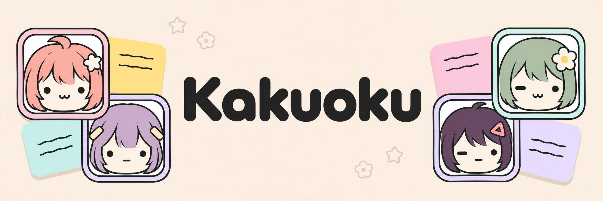

[English](README.md) | **Русский**

# Kakuoku

Все команды выполняются из корня клонированного репозитория `kakuoku`.

Небольшая записная книжка: каждая карточка — тематический чат. Лента в духе
Google Keep, крупные карточки разной высоты, аватарки из референса пользователя.
Рабочее имя и первая версия дизайна, для обсуждения через Agentation.

Рабочая веб-версия запускается через Docker Compose. Порядок установки
на Windows, Linux и macOS и выбор папки данных — в [инструкции запуска](docs/deployment.md).
Node.js на компьютере нужен только для разработки и отдельного помощника переноса.

## Дизайн-демо для разработки

Требуется Node.js 24+. Установите зависимости в клонированном репозитории.

```sh
npm install
npm run dev
```

Адрес: http://127.0.0.1:3100. В правом нижнем углу — Agentation: включите
панель, выберите элемент и оставьте комментарий. Комментарии автоматически
сохраняются в SQLite; кнопка Send также сохраняет весь текущий набор.
Список для агента: `GET /api/feedback` на том же локальном адресе.
Это локальная интеграция callback/API; глобальный MCP Claude не настраивался.
Если сохранение не удалось, интерфейс сообщает, что комментарий остался в браузере.

В настройках → «Хранилище» находится перенос на другой диск через локальный
помощник. В дизайн-демо перенос отключён: оно не меняет рабочие данные и Docker.
Запуск помощника и порядок переноса описаны в разделе «Настройки» ниже.

Под превью — короткий разделитель и строка тегов. В настройках → «Теги» можно
изменить общий набор (до 64 тегов, один на строку).
Поиск принимает `#дизайн`, сочетание `#дизайн #проекты` и текст рядом с тегом;
обычный текстовый поиск также учитывает назначенные теги. AI заново выбирает
3–5 тегов из набора вместе с обновлением превью, в том же запросе. Удаление
тега из набора убирает его с карточек при сохранении. Если в наборе меньше
трёх тегов, модель использует доступные; пустой набор отключает назначение.
В демке теги заранее заданы только у неизменённых демопримеров. Произвольным
заметкам AI-теги не назначаются в демо и режиме «Только запись»; имеющиеся
сохраняются. Старые заметки размечаются при следующем обновлении AI-превью.

В демо можно создавать чаты, сохранять мысли и фото, менять заголовок кликом
по нему, выбирать аватарку и цвет, искать по FTS5, удалять сохранённые заметки
с подтверждением. Пустой черновик не попадает в ленту. Первое отправленное
сообщение, в том числе только с фото, закрепляет заметку. Закрытие без единого
отправленного сообщения удаляет черновик; после отправки — сохраняет заметку
и обновляет превью. Неотправленный текст при явном закрытии не сохраняется.
Окно закрывается без ожидания AI-превью: запрос продолжает выполняться в фоне,
после завершения карточка обновляется. Ошибка показывается в ленте; прежнее
превью и отправленная переписка сохраняются. Пока сервер обновляет превью,
карточка показывает «Обновляю превью…», заметку можно открыть и редактировать.
Устаревший результат AI не перезаписывает заметку, изменённую за время запроса.
AI-превью начинает с актуального итога: явное закрытие задач заменяет их прежние
статусы; закрытый баг-лист не должен повторяться как список открытых проблем.
Чат можно закрыть крестиком, Escape или нажатием на фон во время ответа агента.
Работа продолжается на сервере, карточка показывает волновую плашку
«Агент работает». После ответа она сменяется на «Обновляю превью…», затем
карточка получает новый итог. Закрытие не отменяет и не повторяет AI-запрос.
При ошибке переписка и прежнее превью сохраняются. После перезагрузки страницы
плашки восстанавливаются по состоянию сервера; перезапуск самого сервера
не возобновляет платную работу автоматически. Передача ещё загружаемого файла
должна завершиться до закрытия; это отдельная фаза до ответа агента.
Отдельной кнопки сохранения нет. Примеры и ответы
помечены как примеры. Закрытие изменённого демо-чата собирает локальную текстовую
выжимку, без имитации GLM. Новые демоданные: `.data/demo/kakuoku.sqlite`;
существующая база сохраняет прежнее имя и автоматически открывается без
переноса или переписывания файлов — см. [совместимость хранилища](docs/rename-migration.md).
Никаких запросов к модели в режиме демо, даже если ключ есть в окружении.

Отправляемая реплика появляется в переписке сразу. При включённом AI до ответа
виден временный бабл с тремя точками; он появляется и при повторе запроса.
В исследовании этот же бабл показывает текущее действие: поиск, чтение страницы,
сопоставление материалов. «Ход работы» раскрывает журнал действий сервера;
внутренние рассуждения модели не показываются. После перезагрузки страницы
интерфейс подхватывает состояние выполняющегося ответа без повторного AI-запроса.
При сетевой ошибке текст и фото возвращаются в поле ввода для повтора с тем же ID.
Сообщения поддерживают Markdown: заголовки, списки, жирный/курсив, цитаты,
код, таблицы, task lists и ссылки. HTML не выполняется; внешние картинки
из Markdown автоматически не загружаются. Превью карточек остаются обычным текстом.
Рендер основан на [react-markdown](https://github.com/remarkjs/react-markdown)
и [remark-gfm](https://github.com/remarkjs/remark-gfm).

Сейчас превью строится выбранной моделью чата с общим таймаутом до 10 минут.
Отдельный короткий таймаут и измерение длительности запросов отложены.

Новый дизайн галереи и настроек включается в тот же production-образ.
Стрелки вокруг заголовка переключают заметки и отдельную галерею медиа.
Она получает карточки из серверного индекса страницами по 60 файлов,
ищет по имени файла и названию заметки и открывает оригинал либо заметку-источник.
Текущий дизайн, masonry, анимации разделов и изменённые настройки сохраняются.
Существующая кнопка вложения принимает PNG/JPEG/WebP/GIF, MP4/WebM и аудио:
до четырёх файлов по 128 МиБ, потоковая передача без JSON/base64. Прежние фото
в SQLite продолжают отображаться, переносить их не нужно.
Файлы можно выбрать кнопкой вложения, перетащить в открытый чат или вставить
из буфера через Ctrl+V. Все три способа используют один потоковый загрузчик;
обычная вставка текста сохраняется. Формат определяется сервером по байтам,
а не по расширению или браузерному MIME. Перетаскивание ссылки со страницы
не скачивает удалённый файл: для этого скопируйте само изображение или сохраните
его и перетащите файл. Включённый анализ изображений передаёт модели до четырёх
последних PNG/JPEG/WebP/GIF текущей заметки. Для GIF — только первый кадр.
Это ограниченные JPEG-копии до 1600 пикселей и 1 МиБ, оригиналы не меняются.
Видео и аудио сохраняются и воспроизводятся, их содержимое модель не анализирует.

Для локальных видео сервер по запросу готовит JPEG-постер первого кадра
размером до 640×640, сохраняя пропорции. Постеры хранятся рядом с медиа в
`/app/data/media`; это производные результаты, без анализа моделью.
FFmpeg работает отдельным ограниченным процессом: один разрешённый файл,
без ключей, базы и сети; одна операция одновременно и ограниченная очередь.
Если кодек, ресурсный лимит или sandbox не позволяют получить постер,
галерея пробует обычный видеопревью-элемент; оригинал не удаляется.

Оформление заметки содержит 12 цветов и 6 бледных SVG-узоров. Узор сохраняется
в SQLite и отображается только на карточке и в шапке чата; «Без узора» его убирает.

«Сортировка» открывает окно состояния. В реальном режиме модель сначала
читает сохранённые чаты и предлагает группы по правилам промпта из настроек,
затем отдельным запросом для каждой группы пишет новую общую заметку.
Текст нового чата принимается обычным сообщением, без JSON-обёртки;
короткое превью и теги создаются отдельным вызовом существующего обработчика превью.
Все сводки больше не требуется вмещать в один ответ. Уже объединённые заметки
тоже доступны для следующей сортировки. Модель получает даты изменений
и последних пользовательских сообщений; срок устаревания код не назначает,
просмотры заметок не отслеживаются. В новом чате собираются вложения группы,
повторные ссылки на тот же файл не размножаются.
Исходные записи и файлы сохраняются. Повтор той же группы без новых сообщений
не создаёт дубль; изменившиеся во время обработки исходники пропускаются.
Закрытие окна не отменяет серверную работу. В демо объединение недоступно:
окно явно сообщает, что агент не подключён. Запросы к GLM при разработке
этой функции не выполнялись.

Каждый чат получает постоянное случайное имя собеседника, отдельное от
заголовка заметки. Имя сохраняется в SQLite и не меняется при смене аватарки.

При создании заметки сервер закрепляет за ней шесть разных голов из банка
26 вариантов и случайные цвета рамок. Выбранная голова и весь набор сохраняются
в SQLite. Повторное открытие и смена названия их не перемешивают. Рамка —
отдельный SVG-слой; голова остаётся цельной картинкой. Старые заметки получают
набор один раз с сохранением текущей головы. Каталог — `shared/avatars.mjs`,
20 новых PNG — `public/avatars/heads/`, промпты — `docs/avatar-generation.json`.
Генерация выполнена встроенным imagegen с согласия пользователя; конкретная
модель инструментом не раскрывается.
Существующие заметки получают имена однократно при запуске новой версии.
Нажатием на свою аватарку рядом с поиском можно открыть профиль, заменить
фото (PNG/JPEG/WebP до 2 МБ) или вернуть стандартное. Отдельная крупная
шестерёнка открывает настройки: разделы слева, содержание справа, как в canvastty.
Фото профиля хранится в той же базе.

## Настройки

**Язык интерфейса:** выберите «Русский» или «English» вверху настроек.
Переключение применяется сразу, без кнопки сохранения, и запоминается
в этом браузере. При первом открытии используется язык браузера: русский
для `ru`, английский для остальных языков. Переводятся элементы интерфейса
и служебные сообщения; заметки, переписка, теги, имена файлов и сохранённые
промпты остаются в исходном виде. Язык ответов AI задаётся промптом диалога;
смена языка интерфейса его не переписывает.

В разделе **«Теги»** задаётся общий набор: один тег на строку, максимум 64,
до 24 символов. Сохранение нормализует имена и убирает удалённые теги с
карточек. AI выбирает 3–5 тегов из набора при следующем обновлении превью;
дополнительного запроса модели для этого нет. Поиск `#тег` находит точное
совпадение, несколько тегов — их пересечение. Старые заметки получают теги
при следующем превью; автоматического платного прохода по всей базе нет.

В разделе **«Хранилище»** перенос выполняется через отдельный локальный
помощник на Linux. Требуются Node.js 24+, локальный Docker через Unix socket
и свободное место для полной резервной копии в `.data/host` и новой папки.
Запустите в отдельном терминале из корня репозитория:

```sh
npm run host
```

Откройте настройки приложения на `http://localhost:3101`, раздел «Хранилище».
Помощник показывает фактический volume либо выбранную папку. Укажите новую
или пустую папку вне репозитория, нажмите «Предпросмотр переноса», затем
«Перенести данные». Перенос блокирует новые операции, останавливает контейнер,
проверяет SQLite и контрольные суммы файлов, переключает подключение и
возвращает приложение в работу. Прежнее хранилище и полная копия сохраняются.
Не запускайте одновременно обновление образа или команды управления Compose.

Новая папка должна поддерживать права/владельцев Linux и синхронизацию файлов;
родительская папка должна существовать. Запрещены непустые каталоги, ссылки,
корень диска, домашняя папка целиком и пути с запятыми/двоеточиями.
Подключение сохраняется в локальном `compose.override.yaml`, исключённом из
Git и образа: обычный `docker compose up -d` продолжает использовать новую
папку. Не удаляйте этот файл, пока приложение использует перенесённые данные.
Чужой Compose override помощник не перезаписывает. После прерывания откройте
раздел снова и нажмите «Продолжить восстановление»; после допуска новых
записей автоматического возврата к старой копии нет. Деморежим данные не переносит.

Помощник слушает только `127.0.0.1:3102`, принимает браузерные запросы только
от локального приложения на порту 3101 и проверяет отдельный токен действий.
Docker socket и новые хостовые каталоги в контейнер приложения не передаются.
Для владельцев новой папки используется одноразовый контейнер с доступом
только к этой копии, без сети и с единственной capability CHOWN.

Проверки без браузера и платных API:

```sh
node --experimental-test-module-mocks --test tests/media-input.test.mjs tests/vision.test.mjs tests/tags.test.mjs
```

Интеграционная проверка `node tests/storage-integration.mjs` требует заранее
собранный образ `kakuoku:pending` и свободный порт 3114. Она создаёт отдельный
случайно названный Compose-проект с синтетическими данными, проверяет перенос,
восстановление и сохранность вложений, затем удаляет только свой контейнер и
тестовый volume. Временные папки с синтетическими копиями остаются в `/tmp`.

- **Подключение AI:** базовый HTTPS-эндпоинт и API-ключ. По умолчанию —
  `https://api.ghostmetal.io/v1`; можно также вставить полный URL
  `/chat/completions`, приложение сохранит базовую часть. Модель чата выбирается:
  GLM 5.3 Long, GLM 5.3 или Qwen 3.8 Next. До первого явного выбора действует
  серверный `GHOSTMETAL_MODEL` или `glm-5.3-long`. Отдельный выбор анализа
  изображений: та же модель, одна из этих vision-моделей либо выключение.
  Ключ и endpoint общие. Сохранение не проверяет подключение и не вызывает AI.
- **Агент:** режимы «Чат» (без web tools), «Исследование» (с чтением ссылок
  и поиском), «Только запись» (без любых вызовов AI). По умолчанию остаётся
  «Исследование». В режиме записи превью собирается из мыслей пользователя,
  сортировка агентом недоступна.
- Исследование заканчивается явным итогом: ответом, частичным результатом или
  объяснением нехватки данных. Обещание «поищу дальше» не считается ответом.
  По умолчанию на запрос доступно до 12 обращений к модели; лимит от 4 до 12
  меняется в «Инструменты → Лимит исследования». Последнее обращение оставлено
  для итога, готовый ответ может завершить работу раньше. После остановки
  платного фонового продолжения нет. Найденные страницы и результаты поиска
  сохраняются в SQLite текущей заметки и используются ещё 30 минут после
  последнего отправленного сообщения или действия обработки. Простое открытие
  заметки и опрос состояния окно не продлевают. После истечения окна архив
  остаётся на диске, но автоматически в контекст не включается. В контекст
  выбираются до 50 последних материалов активной сессии и до 80 000 символов
  с учётом общего лимита переписки. Чужие заметки недоступны. Перезапуск сервера
  помечает незавершённую работу прерванной, сохраняя уже полученные материалы;
  продолжение — только новым сообщением или явным повтором.
- Промпты диалога, превью и сортировки редактируются отдельно; для каждого
  есть возврат к исходному тексту. Права инструментов и формат плана сортировки
  задаются сервером независимо от промпта.

Изменения сохраняются кнопкой «Сохранить» и действуют для новых операций.
Уже запущенная операция заканчивается с прежними настройками. Сохранение
не проверяет подключение платным запросом. Демо сохраняет настройки, но не
вызывает модель даже с заданным ключом.

`GET /api/settings` возвращает настройки, значения по умолчанию и признак
`hasApiKey`; `PATCH /api/settings` сохраняет их. Ключ можно заменить или
удалить; пустое поле сохраняет прежний ключ. Секрет хранится в серверной SQLite
вместе с заметками, без шифрования на диске; GET его не возвращает.
В браузерном хранилище его нет. `GHOSTMETAL_API_KEY` используется как fallback,
пока ключ явно не заменён или удалён через настройки. Удаление в настройках
отключает и env fallback, не меняя саму переменную окружения.

### Инструменты

В настройках появился раздел **«Инструменты»**. Для поиска можно выбрать
встроенный DuckDuckGo/Bing без ключа, **Tavily API**, **Brave Search API**
или выключить поиск. Для внешних провайдеров вставьте собственный ключ и
сохраните настройки. Ключи хранятся в серверной SQLite без шифрования на диске;
GET возвращает только признаки их наличия. Пустое поле сохраняет прежний ключ,
«Удалить ключ» удаляет его при сохранении. Сохранение не проверяет подключение
и не расходует лимиты провайдера. Платные сервисы вызываются только после
явного выбора; автоматического платного fallback нет. Реальные обращения
к выбранному API могут расходовать его лимит и оплачиваться по вашему тарифу.

**YouTube и Shorts:** локальный вариант использует
[youtube-transcript-api 1.2.4](https://github.com/jdepoix/youtube-transcript-api)
в production-контейнере, без ключа, cookies браузера, скачивания видео и браузера.
Пришлите HTTPS-ссылку на ролик в заметку и попросите изучить его. В режиме
«Исследование» агент получает `youtube_transcript({video_id})` только для ID
из пользовательских ссылок текущей заметки (`watch`, `shorts`, `youtu.be`,
`embed`, `live`). Из чужой заметки или по произвольному пути получить данные нельзя.
Субтитры сохраняются как материалы исследования с прежним окном 30 минут.
Предпочтение — русский, затем английский, иначе первый доступный язык.

Альтернатива в том же разделе — **Supadata API** с отдельным ключом.
Используется фиксированный transcript API с `mode=native`: только существующие
субтитры, без перехода на генерацию речи, без автоматического переключения
провайдера при ошибке. Это внешний сервис: ему передаётся ссылка ролика.
Другие платформы и генерация субтитров этим инструментом не включаются.

Получить субтитры означает изучить речь, **не посмотреть кадры видео**.
Без субтитров, при возрастном/приватном ограничении или блокировке IP YouTube
приложение сообщает об ограничении. Кадры, музыка и загруженное пользователем
аудио по-прежнему не распознаются. В «Чате», «Только запись» и дизайн-демке
инструменты не вызываются. Для внедрения изменений образ нужно пересобрать
обычной командой `docker compose build` и обновить сервис с прежним volume.

## Приложение через Docker Compose

На Linux нужны Docker Engine и Compose v2; на Windows и macOS — Docker Desktop
с Linux-контейнерами. Хостовая установка Node.js/npm для веб-приложения не нужна.
Команды одинаковы для PowerShell и терминала Linux/macOS и выполняются из корня
клонированного репозитория. Подробности и ограничения — в [deployment.md](docs/deployment.md).
Если приложение уже использовалось, сначала выполните
[переход с существующим хранилищем](docs/rename-migration.md), не создавая новое.
Для первой установки без прежних production-данных:

```sh
docker volume create kakuoku-production-data
docker compose build --pull
docker compose up -d
```

Открыть **http://localhost:3101** (также http://127.0.0.1:3101). Демка продолжает
работать отдельно на 3100. Один сервис раздаёт frontend и API; Agentation заменён
пустым модулем при production-сборке и не обслуживается production API.
Сначала приложение работает как записная книжка. API-ключ задайте в настройках;
сохранение настроек не обращается к провайдеру. `.env` не обязателен, пример
позволяет переопределить модель и выбрать существующий volume через
`KAKUOKU_DATA_VOLUME`. Compose намеренно не передаёт API-ключ
через окружение контейнера. Серверный fallback для нестандартного запуска сохранён.

```sh
docker compose stop
docker compose start
docker compose logs --tail=100 app
```

Остановка и удаление контейнера **сохраняют заметки**: выделенный Docker volume
`kakuoku-production-data` (или явно выбранный существующий volume) подключён
только в `/app/data`. Он объявлен external: при отсутствии выбранного volume
Compose завершится ошибкой, не создавая пустое хранилище. Здесь находятся SQLite,
настройки, профиль, старые фото, новые медиа и результаты сортировки.
Демобаза `.data/demo` не подключается к production и не удаляется.
Для своей папки данных предусмотрен [шаблон локального override](compose.override.example.yaml):
конкретный путь задаётся через `KAKUOKU_DATA_DIR` только в игнорируемом `.env`.
Порядок настройки и переноса существующих данных — в [инструкции](docs/deployment.md#своя-папка-данных).
Контейнер стартует с UID/GID 1000, read-only корнем, без capabilities, с
no-new-privileges, ограничениями 768 МиБ RAM, 2 CPU, 64 процесса и tmpfs `/tmp`
64 МиБ. Единственная публикация порта привязана к IPv4 loopback; используется
обычная сеть Compose, без host network, privileged, устройств или sockets.
Для обновления сначала сделайте резервную копию по [инструкции](docs/backend.md),
затем:

```sh
docker compose build --pull
docker compose up -d --no-deps app
```

Существующий volume используется повторно; миграции добавляют таблицы/столбцы.
Не запускайте несколько серверов с одним volume. `SIGTERM` останавливает приём
запросов, отменяет сетевые вызовы и даёт активным операциям до 25 секунд на
завершение; Compose ждёт 35 секунд. Пользовательское сообщение записано до AI.
Автоматического продолжения платных запросов после перезапуска нет.

Удаление приложения с сохранением данных:

```sh
docker compose down
```

**Отдельное безвозвратное удаление всех production-данных**, только по своему
явному решению, после остановки приложения:

```sh
docker compose down
docker volume rm kakuoku-production-data
```

При `KAKUOKU_DATA_VOLUME` удаление касается фактического выбранного volume;
сначала проверьте его имя. Обычные запуск/обновление не выполняют `down -v`,
`volume rm` или очистку данных.
Не удаляйте старый Podman-контейнер с нужными записями: автоматический импорт
из прежнего writable layer не реализован. Новое production-хранилище отдельное.

[Контракт backend, медиа, резервное копирование и ограничения](docs/backend.md).
Конфигурация задаёт ограничения запуска; фактическая изоляция в Docker пока
не проверялась. Файлы `/.dockerenv` и `/run/.containerenv` не используются как
доказательство изоляции. Защитный флаг `KAKUOKU_PRODUCTION=1` выбирает режим,
но сам по себе ничего не изолирует.

## Electron

Экспериментальная оболочка для разработки, не основной способ запуска.
Полноценный GUI для работы с подключённым каталогом — отдельный будущий этап;
текущая поставка использует браузер и изолированный backend в Docker.

```sh
npm run desktop
```

По умолчанию оболочка открывает демо на 3100; для рабочего приложения:
`KAKUOKU_URL=http://127.0.0.1:3101 npm run desktop`.
Оболочка открывает уже запущенный локальный сервер. У renderer нет Node,
preload, файлового IPC и чтения сохранённого ключа: `sandbox=true`, `contextIsolation=true`,
`nodeIntegration=false`. Сессия непостоянная; заметки не дублируются в localStorage.
Только явно нажатые HTTPS-ссылки открываются в системном браузере.
Electron запускается на хосте и может создавать технические файлы Chromium;
адрес оболочки настраивается отдельно от Docker (см. `electron/main.cjs`).
Удаление контейнера не удаляет volume, код проекта, `.env`, демобазу, комментарии
Agentation или технические файлы оболочки. Это отдельные артефакты разработки.

## Границы агента

- Изолированный сервис — текущий чат → GhostMetal → ограниченные web tools.
  Модель не получает пути, файловые функции, shell, SQL, доступ к другим чатам
  или операции удаления. Сводку записывает приложение, а не произвольный код LLM.
- `read_url`: только публичный HTTPS на 443; все DNS-адреса проверяются;
  IP закрепляется при соединении, каждый redirect проверяется заново.
  Читает HTML, обычный текст и JSON (включая `application/*+json`) через GET;
  параметры API задаются в URL. JSON проверяется и передаётся исходным текстом,
  без округления больших числовых ID. При обрезке модель получает `truncated:true`.
  Нет скриптов, browser/CDP, cookies, файловых URL или локальных подсетей.
- `search_web`: встроенный DuckDuckGo с fallback на Bing RSS, либо выбранный
  в настройках Tavily/Brave. Поиск можно отключить. Ошибки выбранного провайдера
  показываются явно; автоматического платного fallback и имитации результатов нет.
- Сохранённый ключ — только у серверного адаптера. Эндпоинт настраивается;
  соединения разрешены только к публичным HTTPS-адресам на 443, все DNS-адреса
  проверяются, IP закрепляется при TLS-соединении, redirects API запрещены.
  По умолчанию GhostMetal и модель `glm-5.3-long`.
- Старый контракт фото PNG/JPEG/WebP (до четырёх и 10 МБ на сообщение, SQLite)
  сохранён. Новый потоковый API принимает также GIF, видео MP4/WebM и аудио;
  файл до 128 МиБ, общий предел новых медиа 2 ГиБ. Файлы выдаются по ID с Range.
  Проверка типа — по бинарной сигнатуре в ограниченном процессе, не полная
  проверка декодируемости. Для анализа до четырёх последних изображений текущей
  заметки сервер готовит ограниченные JPEG-копии в отдельном sandbox; остальные
  вложения передаются только метаданными. Видео и звук не анализируются.
  Кнопка прикрепления, проигрыватели и галерея
  подключены к потоковому API; контракт описан в `docs/backend.md`.
  Потоковой проверке нужны Landlock/seccomp в Linux-контейнере; при невозможности
  включить ограничения загрузка возвращает 503, без небезопасного fallback.
- FTS5 индексирует названия, превью, всю переписку, URL и имена фото.
  Unicode61, префиксный поиск по словам; без морфологии и OCR.
- Сообщение сохраняется до вызова модели; ошибка API не теряет его.
  Повторная отправка с тем же ID не дублирует сообщение. При ошибке сводки
  прежнее превью сохраняется; есть явное закрытие без обновления.
- Изменения одного чата сериализованы; параллельный запрос получает HTTP 409.
  Превью, ответ и сортировка проверяют ревизию перед записью; новые клиенты
  могут передавать ожидаемую ревизию при редактировании/отправке/удалении.
  Ключ сессии и проверки Host/Origin защищают локальный API от посторонних сайтов.
- Текущий предел передаваемой истории — 350 000 символов. При превышении
  запрос отклоняется с сохранением данных, без тихой потери старых сообщений.

Контейнер уменьшает доступ к хосту; это **не доказательство невозможности escape**.
Ядро общее с хостом. Сеть контейнера нужна для API и исследований; egress firewall
в этой версии не настроен. Запрет приватных сетей реализован в web tools,
а не отдельной сетевой политикой. Вызовы GLM передают текущую переписку провайдеру.
Сервис пока рассчитан на одного пользователя и loopback, не на публикацию в интернет.

## Структура

`src/` — React UI и SL UI; `server/store.mjs` — SQLite/FTS5;
`server/agent.mjs` — единственный адаптер GLM; `server/web.mjs` — ограниченные
инструменты интернета; `server/index.mjs` — HTTP API;
`server/research.mjs` — журнал и ограниченное по времени окно материалов заметки;
`electron/` — тонкая оболочка. Web UI использует только HTTP API и не зависит
от Electron — это основа для будущих клиентов Android и canvastty.
Сами Android-клиент и плагин canvastty в этот этап не входят.

[Визуальные решения и источники SL UI](docs/design.md).
Экспорт SL UI `matte-save-cancel/save` сохранён в `src/vendor/sl-save` как
исходный референс. Кнопка удалена из чата по фидбеку пользователя; теперь этот
controller подключён только к сохранению настроек. Поля адреса и ключа используют
экспорты `matte-url-input/url-input` и `matte-password-input/password-input`.
Rendered source audit не проводился по запрету пользователя на UI-проверки.

Кнопка отправки использует оригинальные CSS, SVG и controller SL UI
`matte-buttons-send-message-v11` / `buttons-send-message-v11` из
`src/vendor/sl-send`. React wrapper подключает реальную отправку и тот же
controller для Enter. Круглая форма и скрытые служебные подписи — адаптация
в стиле Kakuoku. Переходы аватарки, цвета и панели оформления согласованы
с motion исходника. Runtime source audit и визуальная проверка не проводились.

## Источники и статус

- [GhostMetal API](https://www.ghostmetal.io/docs)
- [Agentation API](https://www.agentation.com/api)
- [Docker Compose services](https://docs.docker.com/reference/compose-file/services/)
- [file-type: detection limits](https://github.com/sindresorhus/file-type)
- [Electron security](https://www.electronjs.org/docs/latest/tutorial/security)
- [Node SQLite](https://nodejs.org/api/sqlite.html)

По запросу пользователя образ собран и запущен через Compose; проверены HTTP UI/API,
выдача графических файлов и SSR-рендер Markdown (форматирование, ссылки,
блокировка HTML/внешних картинок). Браузер, Electron, lint/typecheck и платные
запросы GhostMetal не запускались. После исправления закрытия образ пересобран
и установлен; проверены фактически выдаваемый JS и закрытие нового пустого
черновика через production HTTP API. На отдельной временной SQLite со stub AI
проверены задержка, дедупликация, конкурирующая запись, ошибки, удаление,
режим записи, FTS и миграция без потери прежних значений. Закрытие диалога
проверено без браузера с незавершающимся stub-запросом превью. Данные после
перезапуска сверены с полной резервной копией по fingerprint прежних строк.
Ожидание реального AI, семантика нового превью, визуальный результат и
стойкость изоляции отдельно не проверялись.
Эти проверки не являются security audit.

При подготовке 0.1.0 успешно собран production-образ Docker и проверена HTTP-выдача
обновлённого интерфейса с RU/EN. После обновления отпечатки всех таблиц базы
совпали с резервной копией до обновления. Взаимодействие через браузер и платные
запросы к AI в рамках подготовки версии не проверялись.
